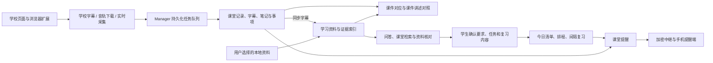

# 项目实现说明

本页先列出当前学习助手的功能入口、代码职责和数据流，后半部分保留原版学校字幕下载实现。功能与交互评审见 [现有功能与直觉性改进清单](planning/CODE_UX_REVIEW.md)；采集与队列细节见 [ASSISTANT.md](ASSISTANT.md)，学习工作台细节见 [STUDY_TECHNICAL.md](planning/STUDY_TECHNICAL.md)，学校接口观察见 [SITE_FINDINGS.md](SITE_FINDINGS.md)。

## 当前功能与代码入口

以下对应当前开发工作区，不代表所有功能都已包含在 README 所链接的旧安装包中。

| 用户要做的事 | 页面或入口 | 主要实现 |
| --- | --- | --- |
| 打开助手、连接学校 | 桌面图标、学习页“连接百步梯” | `scripts/DesktopLauncher.cs`、`start-assistant.ps1`；`extension/desktop-entry.js` 与 `assistant_service/desktop.py` 负责学校连接交接 |
| 上课录音、看字幕和提醒 | `study-popup.html`、`classroom.html`、学校页面浮层 | `background.js`、`offscreen.js`、`pcm-worklet.js`、`overlay.js`；服务端 `app.py`、`manager.py`、`asr.py`、`analysis.py` |
| 整理单节或整门课回放 | 扩展“整理本节回放”、课程笔记“导入课程回放”、对话任务 | `school-api.js`、`background.js`、`study-bridge.js`；`study_agent/operations.py`、`media.py` 与原有转写、笔记队列 |
| 查笔记、事项、字幕来源，恢复或导出记录 | `dashboard.html` | `dashboard.js`、`library-core.js`；`app.py`、`store.py`、`records.py` |
| 上传整门课课件、按字幕和页码双向定位 | “整门课课件”、课件时间轴 | `courseware.js`；`courseware_api.py`、`courseware.py` |
| 按知识点对照课件、原话和笔记 | “课件与讲述对照” | `lecture-compare.js`；`lecture_api.py`、`lecture_materials.py`、`analysis.py` |
| 生成、编辑、导出思维导图 | “思维导图” | `mindmap.js`、本地 Markmap 资源；`mindmap.py` |
| 连续问答、添加附件、查课堂出处 | `study.html` | 当前入口加载 `study-conversation.js`、`study-tools.js`、`study-actions.js`、`study-specialized.js`；服务端 `study_agent/api.py`、`dialogue.py`、`reasoner.py`、`classroom_search.py` |
| 管理资料与核对记录 | “资料与安排”、附件和文件夹导入 | `study-tools.js`、`study-actions.js`；`study_agent/attachments.py`、`ingest.py`、`materials.py`、`storage.py`、`knowledge.py`；`materials.py` 统一资料身份、旧格式复用与明确的版本替换 |
| 管理任务、课表、今日清单和间隔复习 | “今日清单”“任务与日历”“课表”“复习节奏” | `study_agent/daily.py`、`planner.py`、`timetable.py`、`learning.py`、`reviews.py`，由学习页相关脚本展示 |
| 查公开资料、生成学习资料包 | 对话任务 | `study_agent/operations.py`、`references.py`、`research.py`、`exports.py` |
| 配置模型、语音、手机提醒 | `options.html`、Android 提醒端 | `options.js`；`settings.py`、`connection_check.py`、`mobile.py`；`mobile/android/` |
| 查看执行过程、通过 WorkBuddy 使用资料 | “运行详情”、MCP 连接器 | `study-runtime.js`、`telemetry.py`、`study_agent/mcp.py`；接入说明在 `workbuddy/` |
| 仅下载原版学校字幕 | CLI、扩展“原版字幕下载” | 根目录 `main.py`、`browser.py`、`auth.py`、`subtitle.py`、`config.py`；`extension/popup.js`、`core.js` |

表中的前端脚本位于 `extension/`，未单独注明的服务端模块位于 `assistant_service/`。`assistant_service/desktop.py` 负责浏览器连接交接，Windows 托盘的实际实现是 `scripts/DesktopLauncher.cs`。

## 主流程与持久化边界



| 数据 | 负责模块 | 保存位置及边界 |
| --- | --- | --- |
| 课时、导入记录、音频与笔记任务 | `store.py`、`records.py`、`manager.py` | 数据根目录的 `assistant.sqlite3` 与 `sessions/`；原始记录和可比较的字幕覆盖范围分开处理 |
| 资料版本、证据、对话、任务、课表、复习 | `study_agent/storage.py` 及领域模块 | `study-agent.sqlite3`，附件在 `study-uploads/`，资料包在 `study-exports/`；来源更新保留历史引文 |
| 执行事件、模型输入输出与用量 | `telemetry.py` | `agent-runtime.sqlite3`；用于解释执行过程，不作为课程知识库 |
| 配置与凭据 | `settings.py` | 配置位于数据根目录；API Key 按 Windows 用户独立加密保存，扩展不持有模型 Key |

理解状态时需要分别看采集/转写、笔记分析、课件匹配和学习操作的进度。它们可以独立成功或失败，不能用一个“完成”覆盖所有阶段。

## 原版字幕下载：概述

本工具从华南理工大学“华园视频”平台提取课程回放字幕，同时支持校内站点 `video.jw.scut.edu.cn` 和 WebVPN 校外站点 `video-jw-443.webvpn.scut.edu.cn`。华园视频在播放课程时，前端通过 API 拉取字幕 JSON 数据，无需逆向加密或破解流媒体协议。

## 双站点模型

两个站点使用相同的课程页面和 `/courseapi/...` 相对路径，但 origin 与 Cookie 归属不同。程序把站点配置、原始课程 URL、`course_id`、`sub_id` 和 `tenant_code` 组成 `CourseUrl`，后续请求始终继承输入链接所属的 origin。

课程 URL 使用标准库解析并受域名允许列表约束。单课抓取直接打开原始链接；批量抓取只替换 `sub_id`，继续使用相同 origin、`course_id` 和 `tenant_code`。

## 核心发现

字幕接口：
```
GET /courseapi/v3/web-socket/search-trans-result?sub_id={sub_id}&format=json
```

返回结构：
```json
{
  "code": 0,
  "msg": "获取同传结果成功",
  "total": 1,
  "list": [{
    "all_content": [
      {"BeginSec": 93, "Text": "内容", "TransText": "translation", "EndSec": 97},
      ...
    ],
    "sub_id": "554146",
    "resource_guid": "..."
  }]
}
```

关键字段：`BeginSec`（起始秒数）、`EndSec`（结束秒数）、`Text`（中文文本）、`TransText`（英文翻译）。

## 两种实现方式

### CLI 工具（Python + Playwright）

**原理**：Playwright 启动浏览器 → 扫码登录 → 打开课程播放页 → `page.on("response")` 拦截网络响应 → 匹配 `search-trans-result` URL → 提取 JSON。

**技术栈**：
- `playwright` — 浏览器自动化与网络拦截
- `asyncio` — 异步运行时
- `uv` — 包管理与虚拟环境

**模块职责**：
| 文件 | 职责 |
|------|------|
| `main.py` | CLI 入口，argparse 命令路由 |
| `browser.py` | Playwright 浏览器管理、网络拦截、API 直接调用 |
| `subtitle.py` | JSON → SRT/TXT 格式转换、文件保存 |
| `config.py` | URL、路径、超时等常量 |
| `auth.py` | 登录状态持久化（Playwright `storage_state`） |

**关键实现细节**：

1. **登录**：`login --site internal|external` 打开指定入口并完成学校认证，默认保持旧版行为使用 `internal`。登录成功后分别保存为 `data/auth_state_internal.json` 和 `data/auth_state_external.json`，避免不同域名的 Cookie 相互覆盖。校内模式会在新文件不存在时兼容读取旧的 `data/auth_state.json`。

2. **字幕拦截**：必须通过 `livingroom` 页面触发字幕 API 请求。Playwright 用 `page.on("response")` 监听所有响应，只接受当前站点 hostname、精确字幕 API path 且查询参数 `sub_id` 与当前任务一致的响应，避免保存页面预加载的其他课时字幕。

3. **JSON 解析**：API 返回多层嵌套（`body.list[].all_content[]`），`extract_subtitle_items()` 递归展开直到找到同时包含 `BeginSec` 和 `Text` 字段的字幕数组。

4. **课程目录**：先打开当前站点 origin，再通过 `page.evaluate()` 调用相对路径 `/courseapi/v2/course/catalogue?course_id=xxx`。浏览器自动把相对路径解析到校内或校外 origin。

### Chrome 插件（Manifest V3）

**原理**：用户已在课程页面登录 → 插件从当前标签页提取 origin → 构造同站点 API → 直接 `fetch`；遇到网络、认证或跨域限制时在课程标签页内回退请求一次 → 解析 JSON → 生成文件下载。

**技术栈**：
- Chrome Extension Manifest V3
- 原生 JavaScript，无构建工具
- JSZip — 批量导出时打包为 ZIP

**文件结构**：
| 文件 | 职责 |
|------|------|
| `extension/manifest.json` | 声明 `activeTab`、`downloads`、`scripting` 和两个站点权限 |
| `extension/popup.html` | 弹窗 UI（当前课时 / 全部课时双标签页） |
| `extension/core.js` | URL 解析、动态 API、字幕解析和格式转换纯函数 |
| `extension/popup.js` | 接口请求、页面内回退、UI 和文件下载 |
| `extension/jszip.min.js` | JSZip 库，用于 ZIP 打包 |

**关键实现细节**：

1. **无需保存登录凭证**：插件使用当前浏览器会话，`fetch` 设置 `credentials: "include"`。若弹窗上下文受到 Cookie/CORS 限制，则通过 `chrome.scripting.executeScript` 在已验证的课程标签页中重试。

2. **URL 解析**：通过 `chrome.tabs.query` 获取当前标签页 URL，验证 HTTPS、允许域名和 `/livingroom` 路径，再用 `URLSearchParams` 提取参数。API 根地址取 `URL.origin`，不写死某个站点。

3. **批量导出**：调用 `/courseapi/v2/course/catalogue` 获取课程目录，循环 `fetch` 每节课的字幕，JSZip 打包后通过 `chrome.downloads` 下载。

4. **与 CLI 共享逻辑**：JSON 递归解析（`extractSubtitleItems`）和格式转换（`toSrt`、`toTxt`）逻辑一致。两端读取 `tests/fixtures/` 中同一组 URL 与字幕转换向量，防止实现再次分叉。SRT 要求有效开始时间，缺失结束时间使用 `+5s`；TXT 只依赖非空文本。

## 输入与文件路径安全

课程 URL 仅接受受信任 HTTPS 域名、标准端口和 `/livingroom` 路径，拒绝用户名、密码、重复关键参数及非数字 ID。CLI 写文件前会再次验证 `sub_id`、清理课程名，并对三个最终路径调用 `resolve()` 后执行目录包含关系检查。扩展对 API 参数和 ZIP entry 中的 ID 执行同样的二次验证。

## 两种方式的对比

| | CLI | Chrome 插件 |
|---|---|---|
| 登录 | Playwright 登录，校内外状态分开持久化 | 用户在对应站点自行登录 |
| 字幕获取 | 网络拦截（需加载播放页） | 直接 fetch API |
| 批量导出 | 需逐个打开标签页 | 直接循环 fetch，ZIP 打包 |
| 依赖 | Python + Playwright + Chromium | 无（纯浏览器插件） |
| 适用场景 | 本地脚本自动化 | 日常使用，一键下载 |

## 涉及的 API 端点

| 端点 | 用途 |
|------|------|
| `/courseapi/v3/web-socket/search-trans-result?sub_id=&format=json` | 获取字幕数据 |
| `/courseapi/v2/course/catalogue?course_id=` | 获取课程目录（所有课时 sub_id） |
| `/courseapi/v3/portal-home-setting/get-sub-info?course_id=&sub_id=` | 获取课时信息（标题、教师） |
| `/courseapi/v3/multi-search/get-course-teacher-others?course_id=` | 获取课程名称 |

所有 API 均为 GET 请求，需要登录态（Cookie），返回 JSON。
