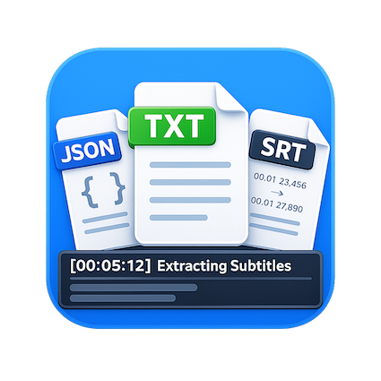

# SCUT Courses Replay Extraction

从华南理工大学“百步梯学堂”中提供的课程回放平台“华园视频”提取**课程回放字幕**，支持 JSON、SRT、纯文本三种格式，可批量导出同一课程字幕并打包为ZIP。浏览器插件和命令行均支持下载回放中的音轨，方便在平台没有字幕或字幕质量不佳时另行转写。

本项目会根据课程链接自动选择正确入口：

| 使用环境 | 站点 |
|------|------|
| 校内网络 | `https://video.jw.scut.edu.cn` |
| 校外网络 | `https://video-jw-443.webvpn.scut.edu.cn` |

校外入口由学校 WebVPN 代理校内站点。程序不会绕过 WebVPN 或学校统一认证；使用前仍需由本人正常登录并拥有相应课程的访问权限。

提供两种使用方式：**Chrome/Edge 浏览器插件**和**命令行工具**。当平台字幕缺失或质量不佳时，也可以下载回放音频后用本地语音识别工具转写；已有可用字幕可以直接使用。

## 免责声明
本项目仅用于个人学习交流与课程复习，使用到的所有内容均来自于课程界面公开信息。
不会绕过学校统一认证，也不会破解视频权限，仅对用户本人已拥有访问权限的课程页面进行字幕提取。

请勿将导出的课程内容用于：

- 公开传播
- 商业用途
- 未经授课教师许可的二次分发

及其他滥用、涉嫌侵害他人隐私或权利的行为。

# 如何使用？

## 方式一：Chrome 插件（推荐）

无需安装任何依赖，在课程页面一键下载字幕。适合日常使用。

### 安装

1. Chrome 网址栏输入 `chrome://extensions/` 打开插件面板或直接点击右上角插件模块进入。
2. 右上角开启 **开发者模式**

3. 点击 **“加载已解压的扩展程序”**
4. 选择本项目的 `extension/` 目录并确定。

安装成功后，浏览器右上角会出现插件图标与名称。

Microsoft Edge 插件安装同理。

### 使用

> **前提**：必须先在当前使用的华园视频入口完成登录。校外使用时要先登录 WebVPN，校内和校外登录状态不能互相替代。

#### 单课时下载

1. 打开任意课程播放页面：校内地址为 `video.jw.scut.edu.cn/livingroom?...`，校外地址为 `video-jw-443.webvpn.scut.edu.cn/livingroom?...`
2. 点击浏览器右上角的插件图标，弹窗显示当前课时信息（课程名、教师、课时标题）
3. 默认只勾选 `.txt`，可按需选择 `.srt`、`.json`，点击 **下载字幕**

#### 批量下载

1. 在弹窗中切换到 **全部课时** 标签页
2. 显示截至当前已生成回放的课时（默认全选），顶部显示识别课时数，并在导出检查后显示异常数
3. 取消勾选不需要的回放，默认只导出 `.txt`，可按需选择其他格式；点击 **下载所选回放字幕 (ZIP)**，下载期间保持弹窗打开
4. 已获取的字幕打包为 ZIP，并附带 `字幕导出结果.json`，逐次记录导出结果及未导出原因

课表中的一行代表一次回放，例如“第 3–4 节”包含两节课。回放次数不等于教学节数；有回放也不一定有字幕。

#### 下载回放音频

如遇到某些课程课时平台缺少字幕，或平台转译效果不佳需要另行转写时，可以在插件中下载回放音轨：

- **当前课时**：点击“下载本次回放音频 (M4A)”。
- **已选课时**：在“全部课时”勾选后，点击“下载已选课程音频”。
- 完成字幕导出后，如果存在“暂无字幕”的课时，会出现对应的音频下载按钮。

音频会保存到浏览器下载目录的 `audio_<课程名称>_<下载时间>/`，每节一个 M4A；任务页支持取消、重试和结果报告，结束前请保留该页面。插件在浏览器内直接提取 AAC 音轨，不重新编码，也不需要 ffmpeg。详细说明、支持的格式和限制见 [回放音频下载](docs/audio-download.md)。

#### 输出格式

| 格式 | 说明 |
|------|------|
| `.srt` | 标准字幕文件，含时间轴，可直接用于视频播放器 |
| `.txt` | 纯文本，无时间信息，便于阅读和搜索 |
| `.json` | 以 `json` 风格切分的字幕，含 `BeginSec / EndSec / Text` 字段 |

#### 常见问题

**弹窗显示"请先打开课程播放页面"**
当前标签页不是华园视频的课程播放页，请先打开一个课程页面。

**下载失败或显示 HTTP 错误**
登录状态可能已过期，请在当前使用的华园视频入口重新登录后重试。校外入口需要重新登录 WebVPN。

**部分课时没有字幕**
新录制的课程可能尚未生成字幕，或平台没有该课时的语音数据。插件会区分“暂无字幕”和“请求失败”，在列表和结果明细中显示原因；即使全部课时都没有字幕，也可以单独下载结果报告。平台返回“未查询到语音数据”时，可以点击插件的音频按钮，或按 [命令行指南](docs/cli.md) 下载回放音频，再交给本地语音识别工具转写。

**批量列表没有显示未来课时**
这是预期行为：批量下载仅列出已生成回放的课时，避免把未开课、直播中或暂无回放的课时当作字幕导出失败。

**下载被浏览器拦截**
Chrome 可能阻止了自动下载，检查地址栏右侧是否有下载被阻止的提示，点击允许/保留即可。

## 方式二：命令行工具

适合接口调试和脚本自动化。安装、登录、字幕与音频下载命令、输出路径及开发检查统一放在 [命令行使用与开发指南](docs/cli.md)。

---

## 没有字幕或字幕质量不佳时

平台字幕缺失、明显不准，或需要更干净的阅读文本时，可以下载回放音频后用本地语音识别工具转写。本地实测中，使用 Whisper Large v3 Turbo 重新转写的文本更便于阅读和整理；术语仍需对照课件校对。

推荐流程：**下载回放音频 → 本地转写 → 校对术语**。需要时间轴时输出 `.srt`；用于阅读和笔记时输出 `.txt`。

macOS 用户可参考 [macOS 本地 Whisper 转写](docs/macparakeet.md)（使用 OpenAI 开源的 Whisper 模型）；其他系统可选择支持课程语言的转写工具。转写由下载后的独立工具完成，本项目不自动安装或调用 ASR。

## 开发与贡献

- [文档索引](docs/README.md)
- [项目架构与实现原理](ARCHITECTURE.md)
- [命令行使用、项目结构与开发检查](docs/cli.md)
- [贡献流程与验证要求](CONTRIBUTING.md)

## 已知限制

- 登录状态会过期，失效后需要重新登录对应站点。

## 权限说明

- 插件仅在 `video.jw.scut.edu.cn` 和 `video-jw-443.webvpn.scut.edu.cn` 页面运行，用于读取当前课程页面信息与字幕接口响应。
- 不会上传任何课程数据，也不会收集用户账号信息。
- 上述说明适用于本项目的插件和 CLI。推荐的第三方转写工具有各自的隐私设置，见 [macOS 本地 Whisper 转写](docs/macparakeet.md)。
