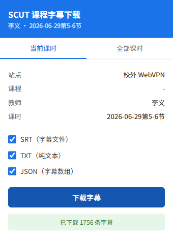
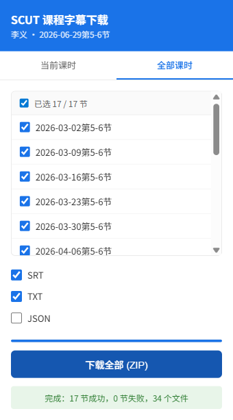

# 实机验收记录

验收日期：2026-07-27。

## 已完成

- WebVPN CLI 单课下载：`sub_id=550530`，字幕接口 HTTP 200，共 1756 条，JSON/SRT/TXT 均成功生成。
- WebVPN CLI 整课下载：`course_id=71826`，目录接口 HTTP 200，共 17 节，成功 17、失败 0。
- WebVPN 扩展单课下载：加载仓库中的未打包扩展，SRT/TXT/JSON 三种下载内容均验证通过。
- WebVPN 页面内请求回退：验收脚本强制中断弹窗的第一次字幕请求，记录到恰好 1 次中断；课程标签页内重试成功并下载 1756 条字幕。
- WebVPN 扩展整课 ZIP：加载真实课程目录后下载默认的 SRT+TXT，并检查 ZIP entry 数量及路径安全。
- 所有目录、课程页和字幕请求的最终 origin 均为 `https://video-jw-443.webvpn.scut.edu.cn`。





截图不包含账号、Cookie 或认证头。测试下载写入一次性临时浏览器目录，完成内容校验后随临时目录清理。

## 环境限制

当前执行环境无法直连校内站点。`login --site internal` 等待 120 秒后超时，且没有可用的校内登录状态。因此以下项目仍需回到校园网或连接学校 VPN 后补测，不能将校外结果冒充校内实测：

- 校内 CLI 单课下载。
- 校内浏览器扩展单课下载及截图。

## 复现扩展回退验收

先登录对应站点，再执行：

```bash
uv run python scripts/live_extension_check.py "课程播放链接"
```

脚本会加载 `extension/`，在临时 Chromium 配置中恢复该站点的登录状态，强制阻断一次弹窗字幕请求，验证页面内回退、SRT/TXT/JSON 下载内容，并把不含凭证的截图写入 `evidence/`。

加上 `--batch` 会继续执行整课 ZIP 验收。
