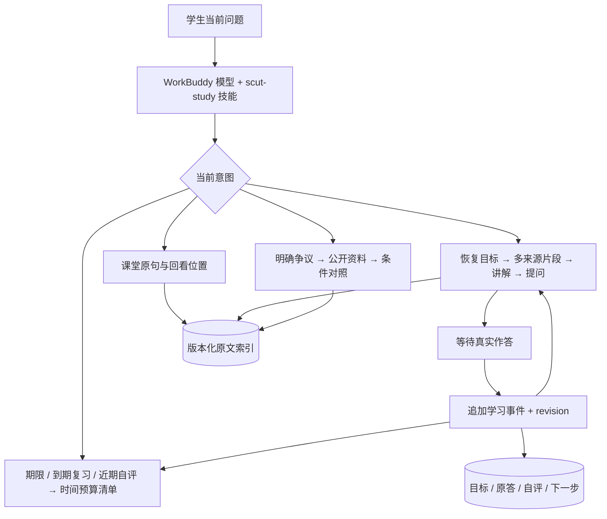

# WorkBuddy Agent：从查资料到连续学习

版本：0.5.0，2026-11-04。对应需求 UX-04、AG-02/03/05/06/08/09/10、EDU-01至10、DEL-03。此文描述已落代码的边界与后续验收，不把宿主技能说明当作平台部署证明。

## 学生的入口

入口是一句当前想做的事，而非四份设置表。查原句直接查；想完整学就建立可接续目标；明确有时间预算才排短清单；遇到矛盾才研究外部来源。只追问当前无法继续的那一项，不先要求填完课表、期限和全部偏好。

例如“从头讲这门课”先看资料目录，按知识依赖建立暂定顺序，随后分轮取证与讲解；“接着上次”先读旧目标和卡点，不能重开第一章；“老师在哪讲过”只需查出处，不强制创建会话。日期用来定位课时，不代替知识结构。

## 执行路径

WorkBuddy负责模型推理与对话，MCP负责确定性检索、来源检查和持久化。没有第二次DeepSeek推理、通用shell或自动执行任意文件内容；普通任务不建Agent团队。新功能使用现有SQLite与stdio协议，不增加Agent SDK。

## 工具为何这样拆

| 操作 | 设计与可观察结果 |
| --- | --- |
| 准备教学上下文 | `prepare_learning_context` 搜24个候选，先分散来源再选最多8段；保留完整片段与预算缺口，课件不轻易被字幕刷满 |
| 确认整课资料范围 | `list_course_materials` 每页20项及next_offset；列标题、类型、版本、片段数，不泄露磁盘路径。清单不等于通读 |
| 核对上下文 | `read_study_evidence_context` 只读同一来源版本前后各0–2段，优先保留焦点，不截断引文；不能由此宣称看过板书 |
| 续接与写入 | 先get再open，步骤带revision与request_id；重试幂等，过时写入拒绝，跨课程证据拒绝，来源过期拒绝 |
| 复习排序 | 最近30天同课程同主题的最新明确自评1/2进入候选；新自评可取代旧卡点，不影响历史。复习暂停/延后仍由原调度负责 |
| 外部研究 | 只发公开概念词，最多两份候选、2–6段对照；同源去重、摘要/正文范围明确。模型意见不是独立文献 |

## 记忆分层

1. **原始依据**：不可原地纠正的资料版本、字幕和位置。失效版本可追溯，但不得当最新通知。
2. **已确认要求与任务**：只读取已接受记录；期限缺失保持空白。学生报告保留其来源，不能冒充教师原话。
3. **学习过程**：`learning_session`记录目标、语言、状态、revision；`learning_step`追加题目、原答、可选自评、证据ID和下一步建议；`learning_topic`仅保留每主题最新自评及证据，排程不用重放全部作答历史。它们不进入已确认知识。
4. **本轮上下文**：最多8段证据、4条相关任务/要求和最近4步；只选当前主题，不重新发送所有对话。原文载荷预算16000字符，相邻片段12000字符；这些不是模型token用量承诺。

自评来自学生，下一步来自助手，未答为空。工具不自动判分，也不以一次模型反馈确认掌握。长期事实、学习报告、模型解释与原文分开，不用一篇自动摘要覆盖它们。新增记录与调用日志都留在本机，不包含在发布包或公开仓库。

会话当前返回最近三项目标，单项目最近四步，事件仍完整保留在本机。长期主题归并、全历史检索与可视化更正界面尚待实现；不通过截取的近期列表宣称全面掌握学习历史。

## 教学与去伪存真

讲解从问题、机制和条件展开；模型切换要解释变量、输入输出、信息取舍与失败边界，再用反事实或一道变式题检验。英语课程在概念引入与定义旁给英文，不仅列末尾词表。学习预算来自当前意图，不能把充足时间的课程默认压成30分钟。

来源检查有四个独立轴：PPT是否同图、谁在说、板书画面是否看过、是否明确联系考试。文本提到“画图”不证明看见教师作图；学生展示不自动升级为教师要求。课堂原话、知识解释、延伸研究分开；外部论文只校核知识，不能替教师指定考试范围。具体规程见 [TEACHING_EVIDENCE.md](TEACHING_EVIDENCE.md)。

这里实现的是证据约束和核对流程，不能保证每个知识判断正确。真正的图像核查、复杂题自动判分、研究结论确认与学生理解程度仍需分别评估，不能由工具执行成功代替。

## 性能与失败恢复

- WorkBuddy的模型直接使用工具结果，MCP不重复调用推理模型。
- 先打包再补读，已有原文不重复取；普通问答不加载研究规程，只有需要时读对应references。
- 相邻片段完整保留，超预算返回deferred ID而非静默截句；来源目录明确遗漏数量并提供分页。
- 写入事务只覆盖当前事件和会话，无长时间网络等待；不同对话过时revision不会互相覆盖。
- 新对话先恢复目标，原文改版提示重取；本地查询不依赖HTTP服务。外网失败与本地索引可用分开。
- 调用与参数沿用运行详情记录；展示实际工具过程和结果，不展示或虚构模型内部思考。

## 平台能力与交付边界

使用官方 [MCP + Skill](https://open.workbuddy.cn/docs/connector) 方式。技能只按需要加载参考规程，安装器会一起复制references并备份变更，保留其他连接器。实时课程状态仍走本机MCP，静态资料库快照须显式导出，不代替版本检查。

复杂来源冲突可以由宿主的一名复核者检查证据；当前未部署固定专家团、可视化工作流或公开Agent链接，不把角色提示当作这些能力已经上线。连接器不能控制录音、任意读取路径、批量转写、导出PDF或发送通知，这些仍从学习助手入口操作。后续按真实用例和权限逐项适配，而非让模型猜工具。

## 验收

测试位于 `tests/test_workbuddy_learning.py`：覆盖多来源打包、资料分页、相邻转场、超预算完整片段、真实要求存储格式、跨课程/失效来源、写入重试、revision冲突、暂停恢复、自评进入清单与后续替代、安装引用规程与保留其他连接器。

人工客户端需分别验证：20个工具与0.5.0状态、匹配目标续接、讲解后停下来等答案、真实学生作答回写、跨对话恢复、明确低自评改变安排、未知板书不被断言为已见、公开资料读取范围不被夸大。自动回归不代替这组交互验收。具体实测范围记录在 [workbuddy/README.md](../workbuddy/README.md)，总台账为 [ACCEPTANCE.md](ACCEPTANCE.md)。

## 课程专门化：0.5.0

课程概念记录只保存名称、易混概念和当前原文ID，不复制解释、不确认知识。调用检索时最多展开4概念/6别名；歧义与失效来源不给自动扩展，学习自评也仅对唯一同概念归并。术语练习把认名与机制/应用拆开，避免一种英文叫法变化就失去检索入口。

目录与检索返回课堂索引覆盖状态。刷新只读已知位置的课堂数据库并同步同一门课，未启动网页也可执行；不从浏览器凭空取课、不转写、不写原始记录。索引缺口与“老师没讲”是两件事。

布尔式工具用专用解析器与最多64行真值表，禁用eval、shell和任意文件访问。只证明二值功能等价，返回反例供解释；HDL、物理时序及综合仍需其他明确验证。课程规程放在条件加载的reference，减少普通查询的提示词成本。
